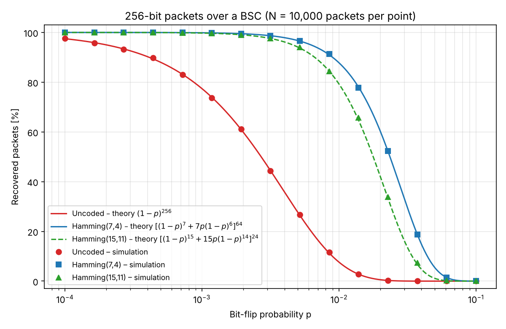

# Sending Packets over a Noisy Channel with a Hamming Code

Each packet carries **k = 256 data bits**. With **Hamming(7,4)** the data is split into 64 blocks of 4 bits and every block is encoded into a 7-bit codeword (448 transmitted bits). The packets are sent over a **Binary Symmetric Channel (BSC)** that flips every bit independently with probability *p*. A packet counts as **recovered** only if all 256 decoded data bits are correct.

## How to run

```bash
pip install -r requirements.txt
python test_hamming.py     # Task 1: exhaustive encoder/decoder check
python simulate.py         # Tasks 2–3 + bonus: simulation and figure (~10 s)
```

Running the simulation saves the figure to `results/recovery_vs_p.png` and the raw numbers to `results/results.csv`. A copy of my run is included in this repository: `recovery_vs_p.png` and `results.csv`.
Use `python simulate.py --n 2000` for a quicker run, or `--seed` to change the random seed.

## Files

| File | Contents |
|---|---|
| `hamming.py` | General Hamming(2^r−1, 2^r−1−r) code: generator matrix, parity-check matrix, encoder, syndrome decoder. Used for (7,4) and (15,11). |
| `test_hamming.py` | Task 1: checks all 16 data words with no error and with every single-bit error (16 × 7 = 112 cases). Also checks (15,11). |
| `simulate.py` | Tasks 2–3: BSC simulation for 15 log-spaced values of *p*, theory curves, figure. |

## Implementation

- **Bit layout.** Positions are numbered 1…7. Parity bits sit at positions 1, 2, 4 and data bits at 3, 5, 6, 7 (`p1 p2 d1 p3 d2 d3 d4`). Parity bit 2^b covers every position whose index has bit *b* set.
- **Encoder.** `codeword = data · G (mod 2)`, with the 4×7 generator matrix G built from that rule.
- **Syndrome decoder.** The parity-check matrix H has column *j* equal to the binary form of *j*. Therefore `s = H · r^T (mod 2)`, read as an integer, is **exactly the position of a single flipped bit** (0 = no error). The decoder flips that position and reads out the data bits.
- **Vectorised simulation.** A whole batch of packets (N × 64 blocks) is encoded, passed through the channel and decoded with NumPy matrix operations, so 10,000 packets × 15 values of *p* × 3 schemes run in a few seconds.
- **Hamming(15,11).** 256 bits do not divide into 11-bit blocks, so the packet is padded with 8 zero bits to 24 blocks (264 data bits → 360 transmitted bits). The padding is dropped after decoding.

## Task 1: Verification

`python test_hamming.py` checks all 16 data words. Each one decodes correctly with no error, and every one of the 7 possible single-bit errors in each of the 16 codewords is corrected: 112 out of 112 cases. For every error position the syndrome equals that position. The same exhaustive check passes for Hamming(15,11): 2048 words × 15 positions.

## Results



The simulated points (markers, N = 10,000 packets per point) lie on the theoretical curves (lines):

- Uncoded: P = (1 − p)^256
- Hamming(7,4): P = [(1 − p)^7 + 7p(1 − p)^6]^64
- Hamming(15,11), bonus: P = [(1 − p)^15 + 15p(1 − p)^14]^24

| p | Uncoded | Hamming(7,4) | Hamming(15,11) |
|---|---|---|---|
| 1.0e-4 | 97.7 % | 100.0 % | 100.0 % |
| 1.2e-3 | 73.7 % | 99.8 % | 99.7 % |
| 8.5e-3 | 11.6 % | 91.3 % | 84.3 % |
| 2.3e-2 | 0.3 % | 52.2 % | 33.9 % |
| 1.0e-1 | 0.0 % | 0.0 % | 0.0 % |

## Answers to the questions

### 1. Shape of the curves, and when the 75 % overhead is worth it

Both curves have the same shape: flat near 100 %, a sharp "cliff", then flat near 0. They fall at very different values of *p*.

- **Uncoded.** A packet survives only if *none* of its 256 bits flips: P = (1−p)^256 ≈ e^(−256p). The cliff is around p ≈ 1/256. The packet is lost half the time already at **p ≈ 2.7·10⁻³**.
- **Coded.** A block fails only if it gets **two or more** errors, with probability ≈ 21p² for small *p*. The packet fails only if one of the 64 blocks fails: P ≈ 1 − 64·21·p² = 1 − 1344p². The loss grows like **p² instead of p**, so the curve stays flat much longer. The cliff moves about one decade to the right, with 50 % recovery at **p ≈ 2.4·10⁻²**.

**Is it worth sending 75 % more bits?**

- *Reliability.* Per 4 data bits, coding wins if (1−p)²(1+6p) > 1, which holds for every p < 0.5. So the coded packet is always at least as likely to arrive.
- *Throughput.* The fair comparison counts correct data bits per transmitted bit: uncoded = P_u, coded = (4/7)·P_c. Coding gives higher throughput when **p ≳ 2.2·10⁻³**.
  - For p < 2·10⁻³ almost every uncoded packet arrives anyway, so the 3 extra bits per block are mostly wasted.
  - For p between about 2·10⁻³ and 5·10⁻², coding is clearly worth it. The uncoded packet almost always fails while the coded one still usually arrives.
  - Around p ≈ 10⁻¹ both schemes fail and neither helps.
- In practice, if a lost packet means a costly retransmission or extra latency, coding pays off even at somewhat lower *p*.

### 2. What happens with two errors in one block?

Hamming(7,4) has minimum distance 3. It can **correct** one error, but it **cannot even reliably detect** two. The syndrome of two errors at positions *i* and *j* is i ⊕ j, which is non-zero and points to a **third** position. The decoder "corrects" that third bit, so the block ends up with **3 wrong bits**.

**Concrete example** (reproducible with `hamming.py`):

| | bits (positions 1–7: p1 p2 d1 p3 d2 d3 d4) | data bits |
|---|---|---|
| Data | | 1 0 1 1 |
| Sent codeword | 0 1 1 0 0 1 1 | |
| Errors at positions 3 and 5 | 0 1 **0** 0 **1** 1 1 | |
| Syndrome = 3 ⊕ 5 = **6** → decoder flips position 6 | 0 1 0 0 1 **0** 1 | **0 1 0 1** |

The decoded data `0101` differs from the sent data `1011` in 3 of 4 bits. The decoder silently outputs wrong data, and the packet is lost. Detecting double errors would need an extra overall parity bit, as in extended Hamming(8,4) / SECDED.

### 3. Longer packets, e.g. k = 1024

Both curves keep their shape but **shift to the left**: a longer packet needs *every* block to survive.

- Uncoded: P = (1−p)^1024. The 50 % point moves 4× lower, from 2.7·10⁻³ to **6.8·10⁻⁴**.
- Coded: P = [block_ok]^256 ≈ 1 − 256·21·p². Because the loss grows like p², multiplying the length by 4 moves the curve only about √4 = 2× lower. The 50 % point moves from 2.4·10⁻² to **1.2·10⁻²**.
- At p = 10⁻³: uncoded drops from 77 % to 36 %, while coded only drops from 99.9 % to 99.5 %.

So **the longer the packet, the larger the benefit of coding**. Uncoded transmission becomes impractical much sooner.

### Bonus: Hamming(15,11)

Hamming(15,11) has a lower overhead: 15/11 ≈ 36 % here, versus 75 %. But each 15-bit block is longer, so two errors in the same block are more likely: block failure ≈ 105p² versus 21p².

| p | Hamming(7,4) recovered | Hamming(15,11) recovered | Throughput (7,4) | Throughput (15,11) |
|---|---|---|---|---|
| 10⁻³ | 99.87 % | 99.75 % | 0.571 | **0.709** |
| 10⁻² | **87.8 %** | 79.3 % | 0.502 | 0.564 |

- **At p = 10⁻³ → Hamming(15,11).** Both codes deliver more than 99.7 % of packets, so reliability is essentially the same. (15,11) sends 360 bits instead of 448, which is about 24 % more useful data per transmitted bit.
- **At p = 10⁻² → Hamming(7,4).** The longer (15,11) blocks now often get two errors, and packet loss more than doubles (≈ 21 % vs 12 %). Raw throughput is still slightly higher for (15,11). But with 1 in 5 packets lost, the retransmissions, latency and buffering usually outweigh the bit savings. The more robust (7,4) code is the better choice.
- The general rule: **low noise → use a longer, more efficient code; higher noise → use a shorter, stronger code**, or a more powerful code altogether.

## Use of AI tools

I used an AI assistant (Claude) as a coding partner. It helped structure the vectorised NumPy implementation and the plotting code, and helped me check the theoretical expressions and phrase the answers. I reviewed, ran and verified everything myself:

- the exhaustive decoder tests;
- the agreement between simulation and theory in the figure;
- the two-error example, recomputed by hand.
